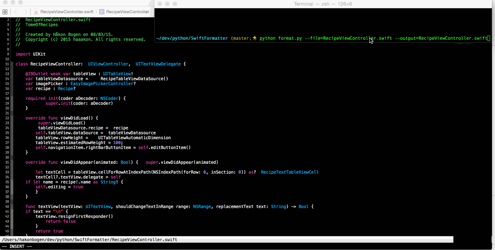

# SwiftFormat

> **Looking for a Swift formatter? Use [nicklockwood/SwiftFormat](https://github.com/nicklockwood/SwiftFormat) instead.**
>
> This repository is an old, unmaintained prototype. The community standard for Swift formatting is **nicklockwood/SwiftFormat** — see the recommendation below.

---

## Recommended Tool: nicklockwood/SwiftFormat

**[https://github.com/nicklockwood/SwiftFormat](https://github.com/nicklockwood/SwiftFormat)**

nicklockwood/SwiftFormat is the actively maintained, feature-rich Swift formatter used widely across the Swift community. It offers:

- **Command-line tool (CLI)** — format Swift files from the terminal, easy to integrate into CI/CD pipelines
- **Xcode source editor extension** — format code directly inside Xcode with a keyboard shortcut
- **Swift Package Manager (SPM) plugin** — integrate formatting as a build tool plugin in your Swift packages
- **Rich rule set** — 50+ configurable formatting rules covering indentation, spacing, braces, imports, and more
- **`.swiftformat` config file** — per-project configuration checked into source control
- **Actively maintained** — regular releases, broad community adoption, and Swift version support

### Installation

```bash
# Homebrew
brew install swiftformat

# Mint
mint install nicklockwood/SwiftFormat

# Swift Package Manager plugin — add to Package.swift
.package(url: "https://github.com/nicklockwood/SwiftFormat", from: "0.54.0")
```

---

## About this repo

This repository was an early prototype (circa 2015) — a Python script that applied basic auto-formatting to Swift code, similar to `clang-format`. It was a proof-of-concept with a small set of indentation rules and a simple test harness.

The original README noted: *"Gonna rewrite this to Swift."* — that rewrite never happened here, but nicklockwood/SwiftFormat became exactly that and much more. This repo is no longer maintained.

---

## Original Content (Historical)

### Usage

```bash
# auto format a file
python format.py --file inputfilename.swift --output outputfilename.swift
```

**Options:**
- `--file [FILE]` — the file to format
- `--output [FILE]` — the file to write the formatted output to

### Demo



### Test format

Put source code to be formatted above `@@@`, and below put the correct expected output after running the format script.

```swift
class test() {{var str = "teststr" }}
@@@
class test() {
    {
        var str = "teststr"
    }
}
```

For each rule added, include a test file showing correct formatting. The test checks that all files are formatted as shown below `@@@`.

#### Run tests

```bash
python tests.py
TEST OK for python/SwiftFormatter/testCases/indentation/indentTest.test
TEST OK for python/SwiftFormatter/testCases/indentation/lotsOfCurlyBraces.test
TEST OK for python/SwiftFormatter/testCases/indentation/mulitplemethodsinclass.test
TEST OK for python/SwiftFormatter/testCases/indentation/prefixedSpaces.test
TEST OK for python/SwiftFormatter/testCases/indentation/twoCurly.test
```

### TODO (original)

- Add a lot more formatting rules
- Be able to turn rules on/off
- Add a plugin for Xcode

## License

MIT

### Author

Håkon Bogen — hakon.bogen@gmail.com
